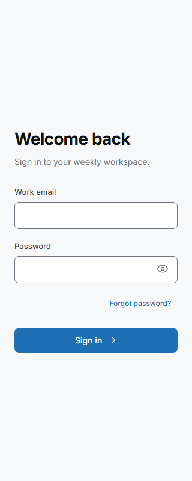
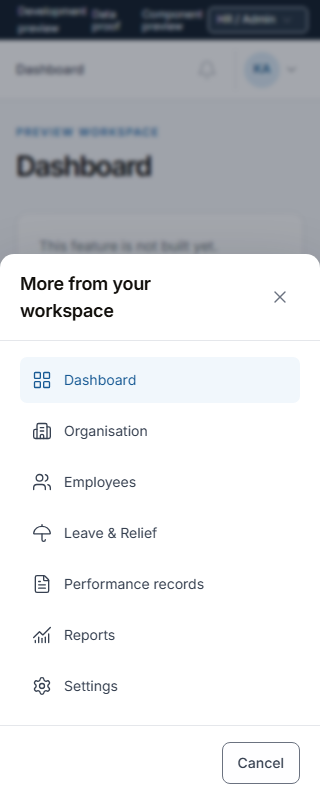

# Feature 7 accessibility verification record

Date: 2026-11-02, Africa/Lagos. This is an implementation verification record, not an independent code review or a full WCAG conformance statement.

## Result and scope

Shared controls, validation, announcements and the selected browser coverage are implemented. Full acceptance remains open for actual NVDA, real browser zoom, authenticated role coverage and the proof composer environment. The user explicitly deferred authenticated checks because Neon rejected the private fixture password saved on this machine. No role spoof, password reset or fake successful API response was used.

| Run | Observed result | Local evidence |
|---|---|---|
| Final development shared inventory, explicitly omitting `real authenticated` cases | 48 passed, zero failures | `.local/verification/feature7/development-verified.log` |
| Compiled production shared inventory with the same explicit omission | 14 passed, zero failures | `.local/verification/feature7/production-final.log` |
| Additional selected HR More forced color keyboard focus check | 1 passed | Captured Node test output, visible focus retains the 2px outline and 3px offset |
| Tooling | Lint, strict checks and production build passed | `npm run check`; test types checked separately |

The full unfiltered authentication coverage did not pass with the available password. Selected runs are reported as selected runs. The final 48 case development run includes the long drawer. Earlier navigation timeouts were resolved by waiting for DOM readiness and required app controls rather than the full load event. Node filtering excludes those tests from its executed count, so a reported zero skipped count does not mean every required test ran. Filter flags are recorded in generated reports.

Automation used Playwright 1.64.1, axe 4.14.0 and Chromium 156.0.8078.4, verified from the installed packages and running browser. The supported normative tag set is `wcag2a`, `wcag2aa`, `wcag21a`, `wcag21aa`, `wcag22aa`. Unsupported tags are errors. Reports retain incomplete rules and separate advisory findings. No normative rule was disabled or blanket excluded.

## Measurements and corrections

| Rendered pair/state | Measurement | Outcome |
|---|---|---|
| Previous enabled field border, `rgb(209, 213, 219)` on white | About 1.47:1 | Fails essential boundary contrast |
| Corrected existing gray 500 border, `rgb(107, 114, 128)` on white | 4.8345:1 | Passes 3:1 |
| Sign in illustration text, existing gray 600 on `rgb(237, 244, 251)` | 6.8139:1 | Passes 4.5:1 |
| Development role selector, white on `rgb(38, 53, 68)` | 12.5364:1 | Computed pair passes 4.5:1 |
| Illustration card headings, `rgb(18, 16, 12)` on white | 19.0020:1 | Computed pair passes 4.5:1 |
| Primary submit text, white on `rgb(31, 111, 181)` | 5.2510:1 | Computed pair passes 4.5:1 |
| Forced color submit text, black on white in emulation | 21:1 | Computed pair passes 4.5:1 |
| Field focus | Existing 2px outline, computed contrast above 3:1 | Passed automated measurement |

The role selector is an axe incomplete result because native select rendering cannot be fully inferred by the scanner. Its computed closed control pair was checked explicitly; native popup/AT behavior is not claimed. Other contrast incomplete results concerned the rotated illustration card headings and the submit control in forced color emulation. Their actual opaque computed pairs and screenshots were inspected and meet the required ratio, as recorded above. The redundant preview time ARIA label was replaced by ordinary text after the scanner flagged it for manual review. Necessary corrections preserve prototype geometry, type scale and color families. Account naming uses native hidden text including the visible staff name and role, while decorative initials and repeated visual identity remain hidden from assistive technology.

The controls and modal states were compared with the approved HTTP prototype references, captured under `.local/verification/feature7/reference-*.png`. The implementation was visually inspected at desktop and 320px. These are browser screenshots and automated viewport/mode checks, not real browser zoom or observed screen reader speech.

## Coverage boundaries

Required built/planned states live in `tests/accessibility/surfaces.ts`. All five role preview configurations are covered at desktop, rail and mobile sizes. Previews confer no real permissions. Shared example forms explicitly say that no task is saved. The actual sign in form is covered for invalid, pending and service error states, with a controlled 503 response used only to exercise failure UI.

Neon intentionally leaves the old local development proof API unmounted. Its unavailable/retry page is covered, but the composer and successful database reply flow remain unverified in this run. Future Employee task, monitoring and role pages are listed as not built and are never recorded as passed.

The Windows computer use helper could not connect to its native pipe. Actual NVDA speech, native 200/400 percent zoom and a real Windows contrast theme were not tested. Emulated reduced motion and forced colors are labeled as emulation. No Firefox, WebKit, Safari or mobile screen reader result is claimed.

## Remaining acceptance

AC-1's shared contract and inventory are written. Shared behavior for AC-2 through AC-5 is exercised, but real authenticated and proof composer consumers still need their checks. AC-6 has automated layout, mode and contrast evidence, with real zoom still open. AC-7's selected automation passes while its full required coverage remains pending. AC-8 has no actual NVDA result. AC-9 distinguishes built and planned surfaces and verifies the reachable production subset. AC-10 has passing tooling, but the complete Test and Verify gates remain open.

Follow the open items in [verify.md](../specs/0006-accessibility-baseline/verify.md). Feature 7 remains in progress. A shared automated success is not the full Test or Verify gate, and no full product accessibility certification is implied.
